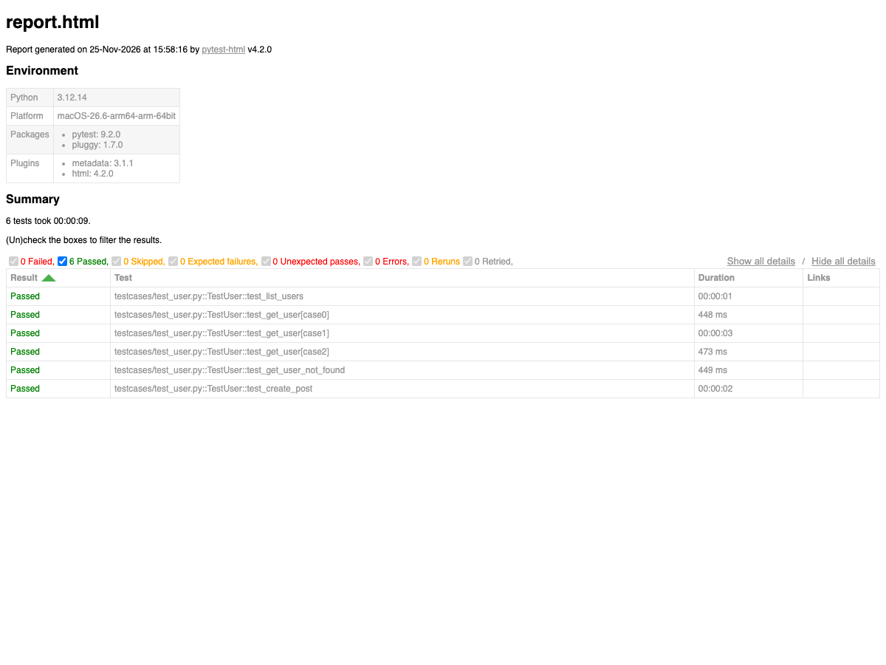

# API Test Framework

基于 **Python + pytest + requests** 的接口自动化测试框架示例，覆盖分层封装、数据驱动、报告输出与 CI 持续集成。


## 特性

- **分层设计**：配置层 / 请求封装层 / 业务接口层 / 用例层，职责清晰，新增接口只改两层
- **数据驱动**：用例数据放在 YAML 中，一份代码覆盖多组输入
- **统一请求封装**：session 复用、超时控制、请求响应日志
- **测试报告**：pytest-html 生成自包含 HTML 报告，可直接归档
- **CI 集成**：GitHub Actions 每次 push 自动执行，报告作为 artifact 上传

## 目录结构

```
api-test-framework/
├── config/                  # 环境配置
│   └── setting.py           # base_url、超时
├── utils/                   # 公共能力
│   └── request_util.py      # 请求封装
├── api/                     # 业务接口层
│   └── user_api.py          # 用户模块接口
├── data/                    # 测试数据
│   └── user.yaml
├── testcases/               # 用例层
│   └── test_user.py
├── docs/                    # 截图与文档
├── .github/workflows/ci.yml # CI 流水线
├── pytest.ini
└── requirements.txt
```

## 快速开始

```bash
pip install -r requirements.txt
pytest                    # 全量执行
pytest -m smoke           # 只跑冒烟
```

报告生成在 `reports/report.html`。

## 测试报告



## 用例设计说明

| 场景 | 用例 | 断言点 |
|---|---|---|
| 列表查询 | `test_list_users` | 状态码 200 + 返回条数 |
| 按 ID 查询 | `test_get_user` | 状态码 200 + 字段值（数据驱动，3 组） |
| 异常场景 | `test_get_user_not_found` | 状态码 404 |
| 创建资源 | `test_create_post` | 状态码 201 + 响应体回显 |

## 后续可扩展

- 接入 Allure 报告，补充步骤与附件
- 增加 token 鉴权、参数化环境切换
- 增加数据库断言层，做接口与落库的双向校验
